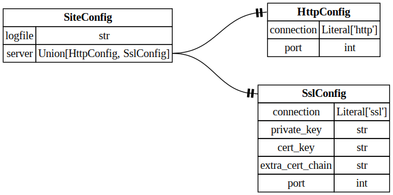

EasyCLI
====

EasyCLI combines [argparse](https://docs.python.org/3/library/argparse.html) and [pydantic](https://pydantic.dev/docs/validation/latest/get-started/) for simple runtime configuration.


Example: SiteConfig
----

Consider the following figure depicting a simple configuration schema for a website.  It provides a `logfile` field and a `server` field.  The `server` type union anticipates a typical behaviorial choice: HTTP or SSL.

### configuration schema



Such a schema is readily defined using pydantic.  EasyCLI provides an additional base class, `ConfigurableModel`, that imbues a `pydantic.BaseModel` with helper methods:

+ `from_yaml`,
+ `from_yaml_source`,
+ `update_from_env`,
+ `update_from_args`

enabling client code:

```python
class SiteConfig(ConfigurableModel, pydantic.BaseModel):
  ...

def main():
  args = argparser_instance.parse_args()

  site_config = (  
    SiteConfig
      .from_yaml_source("config.yaml")
      .update_from_env()
      .update_from_args(args)
  )
```

invoked as:

```bash
EXAMPLE_SERVER_PORT=8000 \
poetry run python3 dev/example.py  \
  --connection http
```


### pydantic defintions

For the above example, the pydantic models are:

```python
from pydantic import BaseModel, Field
from typing import ClassVar, Literal, Union

from easycli.configurable_model import ConfigurableModel

#
# SslConfig
#
class SslConfig(BaseModel):
  connection          : Literal['ssl']
  private_key         : str
  cert_key            : str
  extra_cert_chain    : str
  port                : int = 443

#
# HttpConfig
#
class HttpConfig(BaseModel):
  connection          : Literal['http']
  port                : int = 80

#
# SiteConfig
#
class SiteConfig(ConfigurableModel, BaseModel):
  prefix              : ClassVar[str] = "EXAMPLE_"

  logfile             : str = "/tmp/example.log"  
  server              : Union[HttpConfig, SslConfig] \
                          = Field(discriminator='connection')
```


## Configuration Priority

In the SiteConfig snippet above:
  + environment variables override static configuration, and
  + command line arguments override environment variables.


### yaml config file

As code becomes more mature, it is common to centralize configuration into a common static file.  For our SiteConfig example, this could be as simple as:

```yaml
# config_http.yaml
logfile: ./example.log
server:
  connection: ssl
  port: 8080
```

### environment variables

When code is deployed, it is often convenient to modify static configuration files via environment variables.

EasyCLI uses the following mapping convention for environment variables:

    PREFIX_FIELD_SUBFIELD_ETC=

where this maps to the nested configuration component, `field.subfield.etc`.

`prefix` is specified as a `ClassVar` in the top-level config; that is, the object that inherits from `ConfigurableModel`.  Note, the prefix is stripped off before converting to a nested-attribute index.

### argparse requirements

The final arbiter of runtime configuration is typically the value of a parameter specified as a command line argument.  For python applications, this is often handled by the argparse package.

To integrate with EasyCLI, the client code determines which configuration parameters are exposed on the CLI and how they are named.  The only requirement is that the `dest` argument passed to `ArgumentParser.add_argument` be specified as described above in the environment variable section

For example,

```python
parser = argparse.ArgumentParser()
parser.add_argument(
  "--connection",
  dest = 'EXAMPLE_SERVER_CONNECTION'
)
```

### raised exceptions

EasyCLI attempts to identify unassignable and ambiguous mappings and raise exceptions, respectively.  

Ambiguous scenarios are model specific and would only occur when an assignment request could not disambiguate multiple fields.  The structure to avoid would be a nested model alongside a field where the nested model name is a prefix of the field name.  For example:

```python
class NestedConfig(BaseModel):
  field: int

class BadNameTopLevelConfig(ConfigurableModel, BaseModel):
  nc_field: int
  nc: NestedConfig
```

Then a request to assign a value to `NC_FIELD` would fail.  This is because `nc.field` and `nc_field` collide under the naming convention.  The assignment would be unresolvable.

### type unions

EasyCLI supports type unions.  Thus, a change in configuration will induce a change in the configuration structure.  For example, pydantic may create either an `SslConfig` or `HttpConfig` object for the `server` field.

This YAML generates an `SslConfig` object:

```yaml
# config.yaml
logfile: ./example.log
server:
  connection: ssl
  private_key: ./certificates/ssl/key.pem
  cert_key: ./certificates/ssl/site.crt
  extra_cert_chain: ./pki/intermediate_ca.crt
  port: 4443
```

whereas, this one generates an `HttpConfig` object:

```yaml
# config_http.yaml
logfile: ./example.log
server:
  connection: ssl
  port: 8080
```

## appendix: full example

```python
import argparse

from pydantic import BaseModel, Field
from typing import ClassVar, Literal, Union

from easycli.configurable_model import ConfigurableModel

#
# SslConfig
#
class SslConfig(BaseModel):
  connection          : Literal['ssl']
  private_key         : str
  cert_key            : str
  extra_cert_chain    : str
  port                : int = 443

#
# HttpConfig
#
class HttpConfig(BaseModel):
  connection          : Literal['http']
  port                : int = 80

#
# SiteConfig
#
class SiteConfig(ConfigurableModel, BaseModel):
  prefix              : ClassVar[str] = "EXAMPLE_"

  logfile             : str = "/tmp/example.log"
  server              : Union[HttpConfig, SslConfig] \
                          = Field(discriminator='connection')
#
# build_parser
#
def build_parser() -> argparse.ArgumentParser:
  parser = argparse.ArgumentParser()
  parser.add_argument(
    "--config",
    default = "dev/config.yaml"
  )

  parser.add_argument(
    "--connection",
    dest = 'EXAMPLE_SERVER_CONNECTION'
  )

  return parser

#
# cli
#
def cli():
  """
  invoke:
    $ poetry run python3 dev/example.py --config ./dev/config.yaml
  """
  parser = build_parser()
  args = parser.parse_args()

  site_config = (
    SiteConfig
      .from_yaml_source(args.config)
      .update_from_env()
      .update_from_args(args)
  )
      
  print(repr(site_config))


#
# __main__
#
if __name__ == '__main__':
  cli()
```
